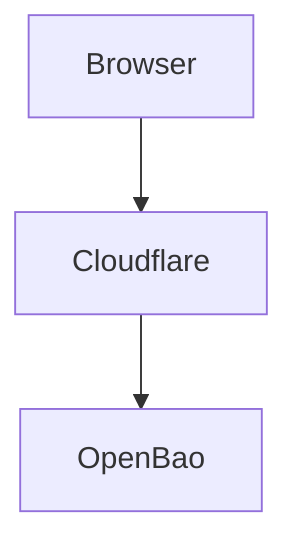

# encanta

`encanta` is a personal blog project built around a static-site workflow.

## Goals

- Keep the publishing pipeline static-first and easy to operate.
- Render Markdown content from a Git-based content repository.
- Provide a polished reading experience with adaptive layouts, light/dark themes, rich Markdown rendering, and media support.
- Keep project communication, documentation, and implementation primarily in English.

## Working Principles

- Never commit directly to `main`.
- Use `<type>/<short-description>` branch names, such as `feat/foo` or `fix/bar`, without an agent or tool prefix. See [`docs/project-rules.md`](docs/project-rules.md) for the branch policy.
- Record design, implementation, and testing decisions in `docs/`.
- Maintain a long-term roadmap in [`docs/roadmap.md`](docs/roadmap.md).
- Keep the main project documentation in English and provide [`README_CN.md`](README_CN.md) for Chinese readers.
- Consider a wiki later if the documentation set grows beyond what the repository structure handles well.

## Repository Layout

```text
.
├── README.md
├── README_CN.md
├── assets/
├── layouts/
├── exampleSite/
├── theme.toml
├── hugo.toml.example
├── docs/
│   ├── changes/
│   ├── project-rules.md
│   └── roadmap.md
└── .gitignore
```

## Documentation Conventions

- `docs/roadmap.md`: long-term planning and phased milestones
- `docs/project-rules.md`: collaboration rules, branching policy, and documentation requirements
- `docs/changes/`: dated or numbered change records for notable design and implementation work

## Current Status

This repository now contains the project governance baseline, the initial architecture definition, and the first Hugo theme skeleton at the repository root.

## Mermaid Diagrams

Encanta renders Markdown code fences labeled `mermaid` as diagrams. Write diagram
content using [Mermaid's syntax](https://mermaid.js.org/intro/syntax-reference.html),
including per-diagram YAML configuration and `classDef` color rules. Encanta does
not add a separate diagram syntax.

````markdown

````

In a flowchart, `TB` lays out nodes from top to bottom; use `LR` for left to right.
See the [Mermaid flowchart reference](https://mermaid.js.org/syntax/flowchart.html)
for other syntax. The theme currently loads Mermaid 12.2.0 from jsDelivr on pages
with diagrams. It uses Mermaid's `strict` security level, which disables
interactive click behavior in diagrams.

## Header Navigation Configuration

The header ships with four built-in items:

- `posts` -> `Articles`
- `tags` -> `Tags`
- `categories` -> `Categories`
- `about` -> `About`

You do not need to restate them in `hugo.toml`. Use `[menu.main]` only when you want to:

- add an extra link such as an external microblog
- override a built-in item by reusing the same `identifier`

The theme merges built-in items with user-defined `menu.main` entries:

- built-in items stay visible by default
- a custom entry with a new `identifier` is appended
- a custom entry with the same `identifier` replaces the built-in one

Example:

```toml
[menu]
  [[menu.main]]
    identifier = "bb"
    name = "BB"
    url = "https://bb.example.com/"
    weight = 5

  [[menu.main]]
    identifier = "posts"
    name = "Articles"
    url = "/posts/"
    weight = 10
```

## About Page Compatibility

The theme renders common standalone page setups, including:

- `content/about.md`
- `content/about/_index.md`
- pages with `type = "about"`

Expected output URL is `/about/`.

If `/about/` opens but shows an empty page, first check whether the consuming site still contains a legacy override such as `layouts/about/single.html`. Hugo gives site-level templates higher priority than theme templates, so an old override can shadow Encanta's `about` template and prevent `content/about.md` from rendering. Removing the stale override lets the theme's built-in `about` layout take effect again.

## Planned Distribution

The preferred installation method for `encanta` is Hugo Modules. Git submodules and manual copies remain supported as secondary options.

## Module Update Workflow

If a site installs `encanta` through Hugo Modules, merging changes into `encanta/main` does not automatically update that site on the next deploy. The consuming site keeps using the theme revision pinned in its own `go.mod` and `go.sum` until it explicitly updates the dependency.

Typical rollout flow:

1. Merge the theme change into `encanta/main`.
2. In the consuming site repository, update the module version:

```bash
hugo mod get -u github.com/miyunda/encanta
```

3. Review and commit the resulting `go.mod` and `go.sum` changes.
4. Deploy the consuming site after that commit lands on its production branch.

This version pinning is intentional. It keeps site builds reproducible and prevents unrelated theme changes from appearing in production without an explicit upgrade.
